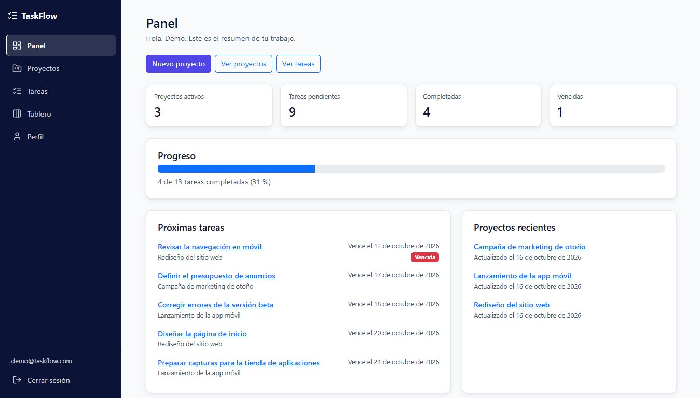
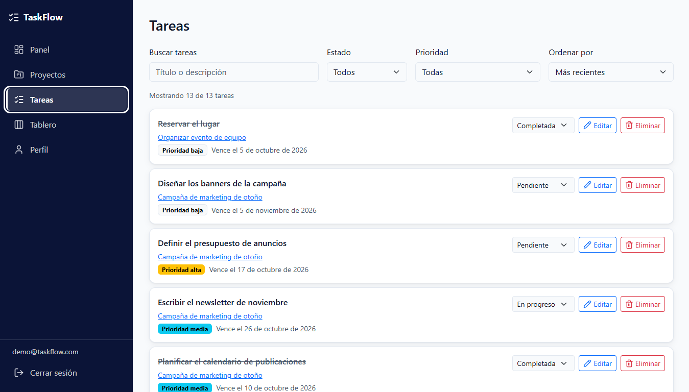
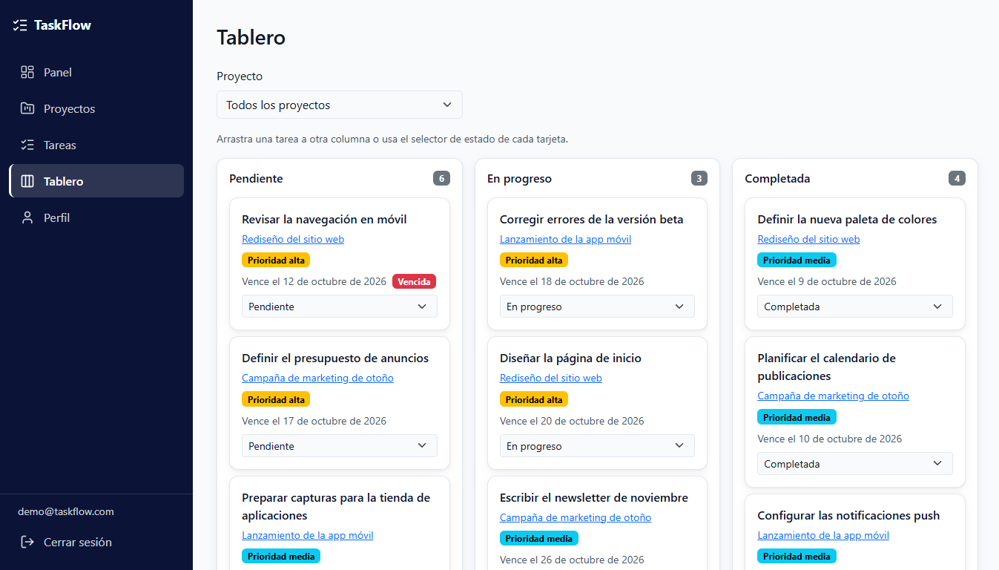
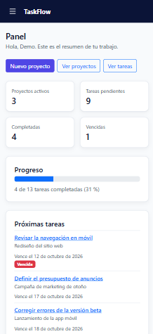

# TaskFlow

TaskFlow es una aplicación web para organizar proyectos y tareas desde un solo lugar. Permite establecer prioridades, definir fechas límite, consultar el progreso y gestionar las tareas mediante un tablero Kanban.

**Demostración:** [Ver TaskFlow](https://taskflow-juan.web.app)

**Repositorio:** [GitHub](https://github.com/juanbecerrap/TaskFlow)

## Acceso de prueba

Puedes utilizar las siguientes credenciales para probar la aplicación:

- **Correo:** demo@taskflow.com
- **Contraseña:** Demo2026.

## Capturas de pantalla

### Panel principal



### Gestión de tareas



### Tablero Kanban



### Vista móvil

<p align="center">
  
</p>

## Funcionalidades

- **Gestión de proyectos:** crear, editar, buscar, archivar y eliminar proyectos.
- **Gestión de tareas:** añadir descripciones, establecer prioridades, definir fechas límite y actualizar estados.
- **Tablero Kanban:** organizar las tareas en tres columnas y cambiar su estado arrastrándolas o utilizando el selector disponible.
- **Panel de estadísticas:** consultar proyectos activos, tareas pendientes, completadas y vencidas, además del progreso general.
- **Búsqueda y filtros:** localizar tareas según sus características y ordenarlas para facilitar su seguimiento.
- **Autenticación:** registro de usuarios, inicio de sesión y recuperación de contraseña.
- **Datos independientes por usuario:** cada persona accede únicamente a sus propios proyectos y tareas.

## Tecnologías utilizadas

- React 19
- TypeScript
- Vite
- React Router
- Bootstrap 5
- Firebase Authentication
- Cloud Firestore
- Firebase Hosting
- React Hook Form y Zod
- Vitest y Testing Library

## Instalación y ejecución local

### Requisitos

- Node.js 24 o superior.
- npm.
- Un proyecto de Firebase para configurar los servicios de autenticación y base de datos.

### Pasos

1. Clona el repositorio:

   ```bash
   git clone https://github.com/juanbecerrap/TaskFlow.git
   ```

2. Entra en la carpeta del proyecto:

   ```bash
   cd TaskFlow
   ```

3. Instala las dependencias:

   ```bash
   npm install
   ```

4. Crea tu archivo de variables de entorno desde la plantilla:

   ```cmd
   copy .env.example .env
   ```

5. Configura en `.env` las variables correspondientes a tu proyecto de Firebase. No compartas este archivo ni subas tus credenciales al repositorio.

6. Inicia la aplicación:

   ```bash
   npm run dev
   ```

Vite mostrará en la terminal la dirección local para abrir TaskFlow en el navegador.

## Pruebas y comandos disponibles

| Comando | Descripción |
| --- | --- |
| `npm run dev` | Inicia el servidor de desarrollo. |
| `npm run build` | Comprueba los tipos y genera la versión de producción. |
| `npm run preview` | Permite revisar la versión compilada localmente. |
| `npm run lint` | Ejecuta las comprobaciones de ESLint. |
| `npm test` | Ejecuta las pruebas automatizadas. |
| `npm run test:reglas` | Ejecuta las pruebas de las reglas de seguridad de Firestore. |

Para ejecutar las pruebas de las reglas de Firestore también se necesitan Java 21 y Firebase CLI.

## Seguridad

TaskFlow utiliza Firebase Authentication para gestionar las cuentas y Cloud Firestore para almacenar los datos. Las reglas de seguridad restringen el acceso a los documentos de cada usuario y validan las operaciones permitidas.

## Despliegue

La aplicación está publicada en Firebase Hosting:

**Demostración:** https://taskflow-juan.web.app

Para generar una nueva versión y publicarla, después de configurar Firebase CLI:

```bash
npm run build
firebase deploy --only hosting
```

Las reglas e índices de Firestore se despliegan por separado cuando sea necesario.

## Autor

**Juan Angel Becerra Padilla**

- [GitHub](https://github.com/juanbecerrap)
- [LinkedIn](https://www.linkedin.com/in/juanbecerrap/)